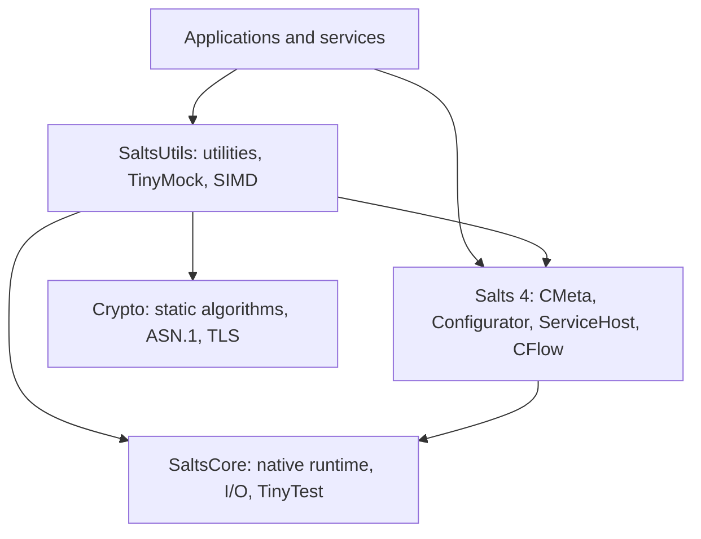

# Canonical source and runtime architecture

The Salts repository implements **only the CMeta/ACE/CFlow layer**.

CMeta/ACE owns type metadata, interfaces, resource scopes, reflection,
interceptors, service construction, component activation and plugin leases.
CFlow owns actor, reactive, DAG and state machine semantics. NativeIO owner,
TCP/UDP/KCP/SCTP transport and system I/O belong to **salts-core**;
cryptographic algorithms, ASN.1 BER/DER and TLS/X.509 belong only to **crypto**.
TinyMock behavior state and descriptor-driven SIMD execution belong to
**salts-utils**; vector/mask reflection metadata remains in CMeta and TinyTest
remains in Core. Neither foundation depends on Utils.

The diagram describes dependency ownership, not package release admission.
Salts #1332/#1333 are merged; the Utils destination remains Draft #732 and its
complete SDK build is blocked. See the [current integration status](README.md#merged-source-and-remaining-sdk-gates--2026-10-31).

## Invariants

1. Each exported target is **`Salts::Name`** regardless of owning package.
2. Salts imports a clean, installed **shared SaltsCore** and never links or
   compiles a second copy of native state.
3. No package aliases, 2.x fallback build, retained native implementation
   headers or compatibility shims.
4. No raw network TLS parser, platform thread implementation, FS/Process
   syscall owner, native SCTP or GmSSL sources in Salts.
5. No CMeta/Reflection dependency in SaltsCore or Crypto.
6. Core and Crypto feature/ABI additions require their own cross-platform
   source and installed SDK conformance before dependent production cutover.
7. Debug/tracing/metrics/adapters implemented with CMeta belong to Salts;
   underlying native resources and handles are owned by Core.

See public headers in `cmeta/`, `component-runtime/`, `plugin/`, and
`cflow/` for concrete ABI and lifecycle contracts. The canonical installed
SDK CI exercises genuine owner and Provider DSO unload paths.
