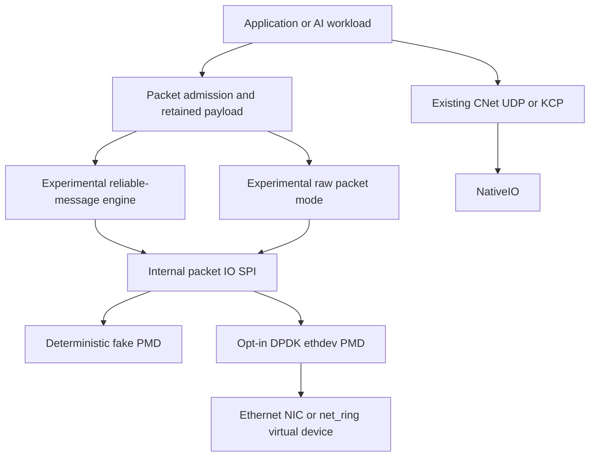

# CNet experimental packet data plane: DPDK and reliable Ethernet research

**Status:** research / no installed API / no production transport compatibility claim  
**Tracking:** [epic #1145](https://github.com/qigao/salts/issues/1145), [packet I/O #1146](https://github.com/qigao/salts/issues/1146), [reliability #1147](https://github.com/qigao/salts/issues/1147), [benchmark #1148](https://github.com/qigao/salts/issues/1148)

## Decision

Investigate a dedicated **Linux-only, explicit opt-in** DPDK PMD packet-I/O lane and an independent reliable-message protocol **inspired by** public TTPoE/MetaRoCE design principles. It is not a substitute for NativeIO and does not implement Tesla's TTP wire format. Neither DPDK nor RDMA is itself a reliable application-message protocol.

CNet already has UDP/KCP/secure KCP, generation-checked packet sessions, tagged logical-send terminals and retained-buffer paths. Use those as baseline semantics and performance comparators; avoid inventing a second general-purpose owner/executor/buffer system.



No integration arrow from DPDK to `native_io_endpoint`: DPDK queues are not sockets, kernel file descriptors, or RDMA QPs. DPDK EAL is initialized explicitly by the embedding host and has process-wide resource implications.

## Execution ownership

- One fixed owner per RX/TX queue; the owner alone calls `rte_eth_rx_burst`, `rte_eth_tx_burst` and any applicable queue cleanup operation. A PMD's lock-free assumptions do **not** permit two owners to poll the same queue concurrently.
- `poll(budget)` is an explicit host operation. The host may interleave its own CNet/NativeIO owner progress and PMD polling but must not create a second implicit native observe authority. There is no hidden polling thread, Actor, or implicit worker pool.
- Off-owner requests use a fixed-capacity command ring with generation identity; same-owner direct admission avoids the ring. Busy / exhausted queues reject admission with a concrete status. Progress fairness and idle CPU cost are measured, not assumed.
- Distinguish process-global DPDK EAL from per-port, per-queue, per-session lifetimes. No DSO hot unload while the EAL, port, DMA buffers, or callback leases remain active.

## Packet I/O SPI (internal only; illustrative C11 signature)

```c
/* Research sketch: NOT an exported Salts public ABI. */
typedef struct packet_io_owner packet_io_owner;
typedef struct packet_io_frame packet_io_frame;

/* Ownership of first *accepted frames transfers to PMD/driver.
   Unaccepted frames remain owned by caller. */
int packet_io_tx_burst(packet_io_owner *owner, packet_io_frame **frames,
                       size_t count, size_t *accepted);

/* RX returns move-owned frame handles. Each must be explicitly released.
   During release, validate owner/port generation and per-frame epoch. */
int packet_io_rx_burst(packet_io_owner *owner, packet_io_frame **frames,
                       size_t capacity, size_t *received);

/* Owner progress, admission sealing and eventual teardown are separate. */
int packet_io_progress(packet_io_owner *owner, size_t budget);
int packet_io_seal(packet_io_owner *owner);
int packet_io_drain(packet_io_owner *owner); /* BUSY until truly quiescent */
```

Real signatures may differ after the fake-provider executable contract is proven. Capacity, affinity, nonblocking progress and exact ownership rules matter more than the spelling.

**Important PMD constraint:** acceptance by `rte_eth_tx_burst` is only PMD ownership/queue acceptance. It is neither a per-packet on-wire completion nor evidence of delivery. PMDs may reclaim accepted `rte_mbuf` storage asynchronously and some do not expose an exact per-packet completion callback. Teardown must respect the driver reclamation boundary; do not fabricate a NativeIO-style TX terminal or free mbufs while the device may reference them. A retransmittable logical message retains separate immutable backing payload until its *protocol* terminal, even if individual TX frame handles are reclaimed earlier.

### Packet ownership table

| Event | Frame ownership | Logical reliable-send ownership |
|---|---|---|
| Reject before admission | caller retains everything | caller retains everything; no callback |
| Packet staged in bounded queue | designated owner holds frame | engine holds retained logical payload if admitted |
| Short TX burst | accepted prefix transferred to PMD; tail remains owner-held | no logical completion |
| PMD queue accepted/reclaimed | driver may hold/reclaim TX mbuf | no logical completion |
| Valid peer ACK | previously DMA-safe frame refs are independently reclaimed | exactly one protocol success terminal, then release when no borrows remain |
| Expiration/final failure/cancel drain | reclaim or wait for outstanding driver references | one documented failure terminal and finalizer |
| Late ACK/stale generation | reject and count | cannot double settle or release |

An ACK must be validated against the live session epoch, sequence space and security/peer authority. The initial experimental framing is **not a secure channel**: without an authenticated peer/ACK design, do not expose the reliable protocol as a production-safe network transport.

## Reliable-message engine

Transport research, independent of PMD:

1. Freeze versioned on-wire envelope in a lab namespace (do not reuse Tesla opcodes or claim interoperability), sequence/ACK ranges, bounded SACK representation, epoch and replay rules.
2. Freeze message policy (ordered vs unordered, max message bytes, MTU, fragmentation/reassembly and integrity). Start single-hop dedicated lab Ethernet; L2 frames are not routable across arbitrary networks.
3. Bound session count, window bytes/packets, retransmission/deadline, delayed-ACK timers, reassembly, out-of-order storage and incast admission. Unbounded timeout/retry loops are forbidden.
4. One admitted tagged message gets exactly one terminal: protocol ACK or a documented terminal failure. A packet resend is bounded transport recovery, **not** automatic replay of an application transaction.
5. Failure cases first: missing data/ACK, duplication, out-of-order arrival, fragment corruption, queue-full, close during TX/ACK, cancellation, stale Generation, disconnection and drain.
6. Any future security/TLS/SM profile must have an independently reviewed transport-authentication and packet-key lifetime. TCP/TLS profiles are not automatically reusable over raw L2.

Tesla's released reference is a GPL-licensed Linux kernel module with associated license/patent notices. Only use public design ideas for this independent research. Wire compatibility, source adaptation or commercialization would require a separate legal/technical review.

## Dependency and CI isolation

- Default CMake paths and installed targets remain unchanged. Experimental target is OFF by default and gated to Linux.
- Only when explicitly enabled, discover a system DPDK via `pkg-config libdpdk` (exact package/version pin recorded with the experiment). No required vcpkg-cache, fallback to native UDP, or mandatory `libdpdk` link for `Salts::CNet`.
- Pure fake-provider conformance is ordinary CI and does not require DPDK, root, hugepages, or a NIC.
- Where installed, test DPDK's `--vdev=net_ring0` for non-hardware `rte_ethdev` functional integration; CI environment must explicitly establish whether EAL memory/driver setup is supported. A skipped/unsupported DPDK environment is not a passed hardware test.
- Linux-specific opt-in compile/smoke only. Keep Windows/macOS SDK and default runtime CI unaffected. CI and ASan/UBSan/TSan apply to the fake-provider/protocol core where feasible.
- Tests assert an exact post-stop drain and Generation fence; unit tests cannot claim real driver DMA reclamation without a hardware-qualified path.

## Measurement and stop/go criteria

Two comparisons are required because packet I/O and reliability are different questions:

| Question | Baseline | Candidate |
|---|---|---|
| Packet processing | NativeIO UDP / CNet UDP | DPDK raw packet mode, same framing/workload |
| Reliable messages | CNet KCP tagged ACK terminal | DPDK + experimental reliable engine, same delivery semantics |
| Future direct-memory transfer | verbs/RoCE on RDMA-capable hardware | **Separate study**; no DPDK emulation equivalence |

For matched NIC, link, queue, MTU, CPU affinity, NUMA and payload, collect per-run p50/p95/p99/p99.9 latency, Mpps/Gbps, core occupancy/cycles per byte, sustained CPU, drops, retransmits, error classification, resource high-water marks and drain time. Test idle, saturated, burst/incast, 0% and nonzero loss/reorder. Publish raw runs and the exact toolchain/driver/kernel/firmware configuration. Do not substitute `net_ring` numbers for physical NIC performance.

Prior to hardware testing, pre-register measurable improvement thresholds **including dedicated-polling-core opportunity cost**. If benefit is absent or cannot coexist with owner/terminal/ABI contracts, stop or retain an internal experiment: do not add a public transport provider simply for API symmetry.

## Non-goals

- No replacement of native epoll/io_uring/IOCP/kqueue, KCP or GmSSL.
- No mandatory DPDK dependency or implicit fallback path.
- No wire-compatible Tesla TTPoE claim, no unreviewed GPL source copy.
- No invented zero-copy, reliable delivery, RDMA or GPUDirect claims.
- No public ABI change while the independent Salts 2.3.0 release gate is open.
- No merge into master as part of this design-only checkpoint.

## Sources

- [DPDK PMD](https://doc.dpdk.org/guides/prog_guide/ethdev/ethdev.html)
- [DPDK ring PMD](https://doc.dpdk.org/guides/nics/ring.html)
- [Tesla TTPoE reference](https://github.com/teslamotors/ttpoe)
- [MetaRoCE design](https://engineering.fb.com/2026/08/24/networking-traffic/metaroce-rdma-transport-ai-ethernet/)
- [NativeIO architecture](../../native-io/ARCHITECTURE.md)
- [CNet README](../README.md)
