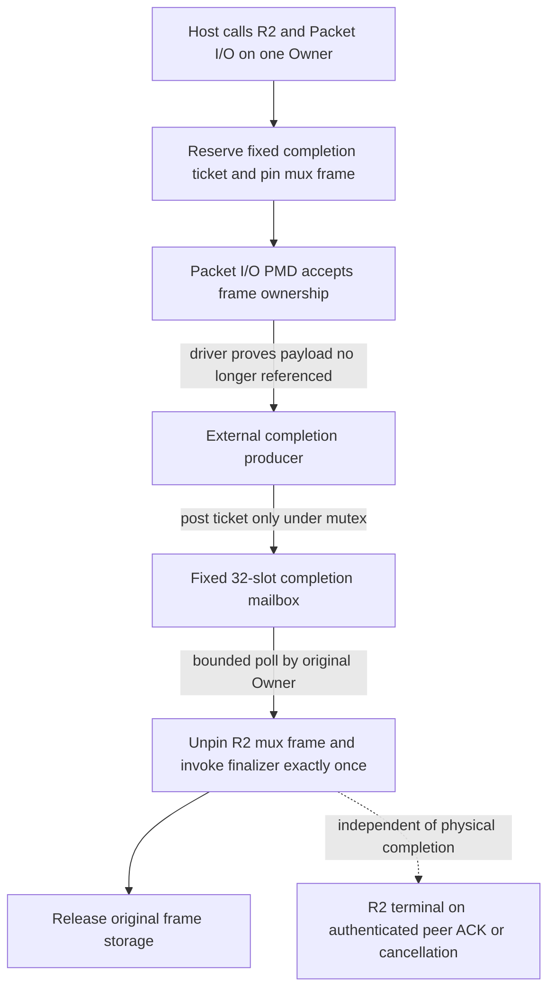

# R2/Packet I/O: off-Owner physical completion handoff

**Research only, DO NOT MERGE:** [Draft PR #1149](https://github.com/qigao/salts/pull/1149), packet I/O [#1146](https://github.com/qigao/salts/issues/1146), bounded Owner mux [#1152](https://github.com/qigao/salts/issues/1152), real-NIC benchmarking [#1148](https://github.com/qigao/salts/issues/1148).

This gate is **not a real DPDK ethdev completion API**, does not interrogate a physical NIC, does not claim remote delivery or IOMMU/DMA safety and **cannot invent driver quiescence**. It is an executable model of the required handoff *after* a backend has independently proven a TX mbuf is no longer in use. Hardware-specific completion/reclaim must be qualified separately.

## One authoritative Owner, one finalizer



The producer **never accesses the mux, MAC lease, R2 protocol or original retained byte pointers**. A background event carries only `r2_dma_ticket{generation,serial,slot}`, and invokes `r2_dma_gate_post` on caller-provided stable gate memory. A 32-slot upper-bound has zero admission-time allocations. Each accepted physical frame reserves a slot **before** the backend can see the frame: when posting, the slot is already reserved; there is no unbounded post queue, lossy enqueue fallback, or ambiguity on capacity exhaustion.

## State machine and hard bounds

```text
   empty --owner:arm/pin--> armed --producer:post--> posted
     ^                       |                        |
     |      owner:rollback---+                        |
     +---- owner:unpin + frame finalizer <- owner:poll/claim
```

- `arm`: on the fixed Owner only; fails FULL before Packet I/O admission if 32 in-flight completion slots or the session-specific physical ref cap are exhausted. Calls the **existing** `r2_mux_frame_pin`; it is NOT a separate reference-accounting authority. Records a full 64-bit monotonic serial plus gate Generation and mux slot-Generation.
- `rollback`: only on Owner before the accepted physical handoff. If `packet_io_submit` rejects, unpin and invalidate that armed ticket; the original frame remains caller-owned. A posted or claimed ticket cannot be rolled back.
- `post`: a producer may only change an already-armed record to POSTED while holding a pthread mutex. Duplicate posts return DUPLICATE, stale generations/tickets return STALE, and no R2/data-plane callbacks run on this producer thread.
- `poll`: bounded to a caller-supplied budget of 0–32. The original Owner exclusively claims POSTED records with a **round-robin slot cursor**, then executes **exactly one** mux unpin and finalizer, in that order. A continuously re-armed low-numbered slot cannot starve an already-posted higher-numbered slot across budget-one polls. Slot reuse gets a *new* serial, so delayed or duplicated events cannot reclaim a new frame. Reentrant Owner entry during a finalizer is BUSY.
- `seal`: stops **new admission** but allows posts to already-ARMED records. `drain` returns BUSY while any armed, posted or reclaiming reference remains. `stop` additionally requires the explicit external-producer joined/fenced assertion and empty mailbox; there is no automatic timeout that frees DMA buffers.
- `fence_joined_producers`: **host contract only**, not a driver proof. The host has already stopped and joined all asynchronous event producers and proven the device/driver will no longer post or dereference gate storage. New posts are refused. Never call it as a substitute for vendor-specific port stop, mbuf reclaim or IOMMU teardown.
- `destroy`: legal only after successful stop, with joined/fenced producers; the host must also keep the mux, its Owner and retained frames alive until all corresponding references are released. Cross-generation re-use retains serial watermark and rejects old tickets.

`r2_dma_gate` uses exactly one fixed mutex for small control-plane completion notifications. It has **no hidden thread, retry scheduler, CPU polling policy, new Actor runtime, dynamic task queue or general-purpose DSO registry**. The PMD queue itself must still have a single Owner; this gate's non-Owner API is restricted to the completion token mailbox only.

## Deterministic cross-thread tests

`tests/dma_completion_gate_test.c` is included in the default standalone research CTest matrix (GCC/Clang ASan+UBSan, GCC TSan) and the exact pinned GmSSL/Salts.Native SDK test builds. It uses real POSIX worker threads but a **fake physical device**, not an actual NIC.

1. Send a valid HMAC-authenticated R2 DATA frame through `packet_io_submit`/TX burst. Simulate a driver retaining it, then cancel the accepted logical message: exactly one CANCELLED terminal, **zero** physical finalizer invocations.
2. Seal R2/Packet I/O and attempt stop while physical reference remains: both completion gate and Packet I/O independently return BUSY, while mux detach refuses the held frame.
3. After the producer has observed fake driver completion, post the pre-reserved ticket **from a different thread**, then attempt posting the same ticket twice. The worker's direct `r2_mux_frame_unpin` must be rejected as WRONG_OWNER.
4. Join producer, explicitly fence, poll on the original Owner and require **one** finalizer. The physical frame can then be detached without issuing a peer-ACKED terminal.
5. Reserve a two-slot completion mailbox, demonstrate a third admission fails FULL without altering physical ref counts, rollback a still-ARMED admission, submit concurrent posts for the remaining two records, detect duplicates, drain in two separately budgeted polls, then restart gate Generation N+1 and reject all old tickets.
6. Re-arm slot zero between two budget-one Owner polls while slot one already has an older posted completion. The next poll **must** reclaim slot one before the newer slot-zero token; all three finalizers execute once in 1,2,3 order.

Tests are correctness and lifecycle checks. They do not measure NIC completion delay, DMA safety, true hardware throughput, real device reset, kernel packet trace, virtual addresses still retained by hardware or per-core busy polling cost.

## Physical NIC qualification still required

Before any real Ethernet packet backend can leave research, supply a named PMD and NIC family, pinned driver/firmware, explicit per-queue Owner placement and event/reclaim source, memory pinning contract, IOVA/IOMMU lifetime, safe `rte_eth_tx_done_cleanup`/driver reclaim handling, quiescence oracle and device detach fencing. Re-run with a hardware lab that actually has that NIC, including deterministic close-vs-completion/port reset interleavings and TSan wherever supported. Do **not** generalize the `net_ring` loopback predicate to physical DMA.

Hardware benchmarks belong in [#1148](https://github.com/qigao/salts/issues/1148), comparing matched authenticated message/ACK semantics against NativeIO UDP/KCP, collecting queue occupancy, p50/p95/p99/p99.9, Mpps/Gbps, cycles/byte, actual dedicated-core load and shutdown latency. No hardware metrics are claimed here.

The R2 MAC and Owner generation contracts remain independent of the lower physical finalizer. Neither a correct off-Owner mailbox nor a signed ACK proves business-level durable exactly-once settlement.
