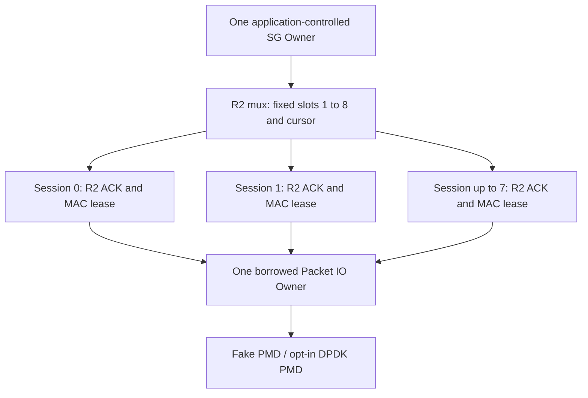

# Fixed-Owner R2 multi-session scheduler: research checkpoint

**Tracker:** [#1152](https://github.com/qigao/salts/issues/1152) under [#1147](https://github.com/qigao/salts/issues/1147), development [Draft PR #1149](https://github.com/qigao/salts/pull/1149). This is **not** an installed Salts/CNet API, hardware-NIC production backend or full multi-peer congestion algorithm.

## Ownership and boundaries

The mux has **one fixed pthread Owner**, a generation-safe mux owner incarnation, at most eight occupied slots, and independently monotonic per-slot handle generations. Each slot borrows an existing, already-initialized `rl_session` and its exact `rl_ticket`, recording `local_id, peer_id, epoch`. The session (and its TX/RX 32-byte HMAC credentials) belongs to the existing R2 Owner and MAC lease; the mux neither duplicates keys nor creates a crypto provider, Actor runtime, thread, socket, allocator, or global registry.

The host supplies `r2_mux_step(now_ms, budget)` with a **maximum of 64 per-call grants**. Each selected live slot receives `rl_step(..., 1)` and a maximum of one packet emission per visit. Cursor advances on every visit, including blocked/empty slots; the loop stops after an entire no-progress round. A full per-peer or global physical TX queue returns **no admission** through the existing synchronous R2 emit callback. Other peers still receive their visit and the cursor is not pinned to the failed peer. The scheduler reports child failure without stopping healthy neighbors, and exposes the individual R2 error as `slot.last_error`. The host still owns CPU polling policy, fairness of inbound Rx bursts, and NIC queue affinity.

## Demultiplex, authentication and identity

Incoming Packet I/O callback borrows a packet for the duration of `r2_mux_input`. The mux performs only bounded **untrusted** header lookup by source ID, destination ID, and epoch. R2 then validates the complete frame envelope and **mandatory 32-byte HMAC-SHA256** before delivering DATA or accepting a peer ACK. An unknown/old tuple is explicitly `R2_MUX_UNROUTABLE`; a matching slot with malformed or forged auth returns `R2_MUX_OK` with the actual child `RL_PROTOCOL/RL_AUTH_FAILED` outcome, never an ACKED terminal. There is no automatic rerouting or downgrade to CRC-only/UDP/KCP.

A newly attached slot receives a generation-safe handle that is independent from the R2 session ticket. Stale handles cannot pin/unpin or detach a new incarnation. The mux retains the last peer/epoch tuple as an **immediate tombstone** against accidental same-epoch reuse of the freed slot. This is **not** comprehensive replay history: the trusted host must uniquely provision/rotate epoch and keys for every newly admitted identity, including process restarts; no raw runtime persistence is introduced.

## Logical completion versus physical reclamation

The caller's R2 emit callback first pins a **bounded per-peer physical credit** (`r2_mux_frame_pin`), then copies the signed frame into stable host storage and calls `packet_io_submit`. On rejection it immediately unpins without transferring a frame. Upon actual physical driver reclamation, exactly one finalizer invokes `r2_mux_frame_unpin`; ACK and Cancel do **not** decrement this count. A slot cannot detach unless its R2 session is STOPPED **and** its physical reference count is zero.

Independent shutdown:

1. Seal/abort/drain/stop R2 sessions as appropriate; settle each admitted logical TX once. The MAC lease remains live while authenticated protocol callbacks can still execute.
2. Wait for the real Packet I/O driver's terminal/free callback for every accepted frame. A pending frame makes `r2_mux_detach` return BUSY even after protocol cancel/stop.
3. Release each now-quiescent MAC lease and detach its slot with the correct mux handle.
4. `r2_mux_seal` prohibits new attachments, then `r2_mux_drain` and `r2_mux_stop` finish only when all slots are detached. Independently seal/drain/stop the physical Packet I/O Owner.

This research harness runs all finalizers on the same thread. A real NIC DMA completion that arrives off-owner must be routed to the authoritative Owner before unpin; it may never access a freed slot, even if a delayed ACK or cancel has already settled the logical message.

## Deterministic conformance

`tests/r2_mux_test.c` exercises one shared `packet_io_owner` Fake PMD with multiple distinct HMAC-protected R2 sessions and independently leased crypto contexts:

- 1, 2, 4, 8 active sessions, one-per-peer packet grant and same-order ACK settlements, with exact finalizer accounting.
- **16 consecutive rounds with eight peers (128 authenticated frames and 128 ACKs)**, with every round proving each peer receives one grant before any next-round send, and no physical reference leaks.
- Per-peer authentication-Provider failure on one of four peers: only the affected logical send settles with a fail-closed error while the other three continue and finish with authenticated ACKs; no application replay is attempted.
- Global Packet I/O queue capacity two under four busy peers; the first two drain and the next two then obtain grants. A permanently blocked peer does not starve the other three.
- One forged ACK fails HMAC while healthy peers succeed; only the affected peer requires its ordinary bounded R2 retransmission.
- Eight simultaneous inbound DATA messages are demultiplexed correctly; local ACKs are scheduled fairly and remote logical TX settles only after those ACKs.
- A direct cancel after PMD queue acceptance publishes one logical CANCELLED terminal but **cannot detach** until the physical frame is actually released; a late old ACK/handle is refused after Generation and epoch change.
- Explicit wrong-thread and reentrant callback scheduling refusals and a strict 64-grant budget cap.

GCC/Clang ASan+UBSan, GCC TSan, the published Salts.Native 2.3.0-rc.14 SDK consumer and GmSSL/DPDK software PMD remain **independent** checks in the scoped research workflow. A virtual/fake PMD is not evidence of real NIC DMA teardown, effective CPU utilization or throughput.

## Bounded fairness telemetry and adversarial replay (next checkpoint)

All counters are **Owner-local, saturating 64-bit diagnostics**, never coordination state: `visits`, `grants`, `idle_visits`, `errors`, `denied_pins` and `peak_physical_refs` per slot. A grant counts *Packet I/O staging acceptance*, not remote ACK, physical DMA completion or business commit. A denied pin preserves capacity and never releases a frame. The field `peak_physical_refs` is bounded by the configured per-slot limit (maximum 16); protocol/PMD counters do not form a second ownership registry.

`r2_mux_test.c` now additionally verifies two deliberately different deterministic failure workloads:

- **Selective loss + ACK replay storm:** eight peers emit DATA, the fake wire reverses arrivals, loses one DATA and duplicates another. The host loses one authenticated ACK and leaves two peers unsettled; RTO selectively retransmits only those two messages. After eight exactly-once ACK terminals, the test replays 128 valid old ACKs and sixteen invalid-HMAC ACKs. Neither path re-settles a completed message. Each bad MAC increments only the matching peer's error counter; no fallback occurs.
- **Two-descriptor sustained fairness:** sixteen independent rounds with eight always-ready peers and a physical TX queue capacity of two. Each round requires exactly four two-peer waves, with no peer receiving a new grant before all eight obtain one. The total is 128 authenticated DATA and 128 ACKs; each slot reports exactly 16 accepted grants and one physical reference as its peak in this workload. No heap-growth, frame leaks, or invented delivery completion is permitted.
- **Per-peer credit limit:** the hard limit is four physical pins in the fixture. A fifth pin returns FULL and increments only that slot's `denied_pins`; another slot can still pin; double unpin explicitly fails.

These are reproducible **fake wire/fake PMD functional conformance bounds**, *not* physical NIC latency or statistically meaningful network fairness. Actual large-scale incast, off-Owner NIC completions and independent provider lease hot-unload remain the next gates.

## Open #1152 / #1148 gates

- [ ] Extended adversarial stress under hardware incast, true independent loss sources, repeated key revocation and bounded scheduler/PMD telemetry. Deterministic ACK storms and a **16-round / 128-frame two-descriptor fairness bound** are research conformance checkpoints, not a real-NIC statistical proof.
- [ ] True multi-NIC/DPDK physical Rx/Tx queue integration, off-owner completion routing and real DMA lifetime safety (see #1146).
- [ ] Authenticated peer/key authority and secure rekey across process restart (#1151).
- [ ] Hardware-accurate congestion/ECN/pacing, larger message fragmentation, MTU discovery, multi-hop routing, real interface hot-unload and exact KCP comparator (#1148).
- [ ] Public ABI or stable installation only after independent consumers justify shared semantics; Draft PR #1149 stays **DO NOT MERGE**.

No automatic business retry, hidden fallback, new runtime scheduler or Tesla TTPoE interoperability is claimed.
